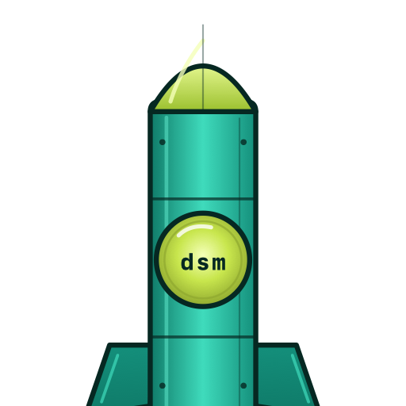

<div align="center">



# .NET SDK Manager

**A cross-platform terminal UI for managing .NET SDKs and Runtimes**

[](https://github.com/shahabganji/dotnet-sdk-tui/actions/workflows/build.yml)
[](https://opensource.org/licenses/MIT)

[Documentation](https://sdk-manager.net)

</div>

`.NET SDK Manager` is a keyboard-driven terminal application built with **Spectre.Console** and compiled with **NativeAOT**. It wraps the official [`dotnetup`](https://aka.ms/dotnetup/docs) CLI to provide a fast, visual experience for discovering, installing, updating, and removing .NET SDKs and Runtimes — all from a single screen.

## Features

- **Animated startup banner** — Aspire-style block letter animation with a teal-lime shine sweep
- **Tabbed workspace** — Copilot-CLI-style tab strip switches between SDKs, Runtimes, and Search with a single `Tab` press
- **SDKs tab** — View installed SDKs alongside the latest available versions for active and preview channels. Install, uninstall, and update with a single keystroke
- **Runtimes tab** — Same experience for .NET and ASP.NET Core runtimes
- **Workloads workspace** — Press `w` on any installed SDK row to manage its workloads (MAUI, Android, iOS, wasm-tools, Aspire, …). Wraps the native `dotnet workload` CLI and scopes every command to that SDK's feature band via a scratch `global.json` — so multi-band installs are cleanly isolated
- **Live search tab** — Non-blocking search with debounce and request cancellation. Type to search, results update as you go — the terminal never freezes
- **Setup panel** — Install and manage the `dotnetup` tool itself from within the app
- **Dark / Light themes** — Press `F6` to toggle. The terminal background adapts via OSC 11
- **Lifecycle icons** — At-a-glance status for each version: 🍀 Active, 🏭 Preview, 🚧 Maintenance, 👿 End of Life
- **Safe install & uninstall** — Before every SDK/runtime install or uninstall, dsm pins your other installed versions so dotnetup's cleanup never removes them; uninstall removes only the version you selected
- **Scroll windowing** — Panels scroll smoothly when you have many installed versions
- **Graceful exit** — Goodbye message on both `q` and `Ctrl+C`
- **NativeAOT compiled** — Fast startup, small binary, no runtime dependency

## Navigation

| Key | Action |
|-----|--------|
| `Tab` / `Shift+Tab` | Cycle tabs: SDKs → Runtimes → Search |
| `↑` / `↓` or `j` / `k` | Navigate rows |
| `i` | Install selected SDK / Runtime / Workload |
| `u` | Uninstall selected SDK / Runtime / Workload |
| `p` | Update selected SDK / Runtime, or all workloads in the Workloads workspace |
| `w` | Open the Workloads workspace for the selected installed SDK |
| `Shift+P` | Repair workloads (Workloads workspace) |
| `m` | Toggle workload update-mode `manifests` ↔ `workload-set` (with confirm) |
| `r` | Refresh data |
| `s` | Toggle focus on the Setup panel |
| `Esc` | Clear search query (on the Search tab) |
| `F6` | Toggle dark/light theme |
| `Esc` | Return to main screen from a workspace |
| `q` or `Ctrl+C` | Quit |

## Installation

```bash
# macOS / Linux (glibc; Alpine/musl isn't supported yet)
curl -fsSL https://raw.githubusercontent.com/shahabganji/dotnet-sdk-tui/main/install/install.sh | bash
```

```powershell
# Windows (PowerShell 7+ or Windows PowerShell 5.1)
irm https://raw.githubusercontent.com/shahabganji/dotnet-sdk-tui/main/install/install.ps1 | iex
```

Running the install script again will update `dsm` to the latest release.

Installer options (environment variables work with both one-liners; `install.sh` also accepts `--install-dir`, `--version`, `--archive`):

| Variable | Purpose |
|----------|---------|
| `DSM_INSTALL_DIR` | Install location (default `~/.local/bin`, Windows `%LOCALAPPDATA%\dsm`) |
| `DSM_VERSION` | Install a specific release, e.g. `v0.9.3` (default: latest) |
| `DSM_ARCHIVE` | Install from a local release archive instead of downloading |

```bash
curl -fsSL https://raw.githubusercontent.com/shahabganji/dotnet-sdk-tui/main/install/install.sh | DSM_VERSION=v0.9.3 bash
```

### Uninstall

```bash
curl -fsSL https://raw.githubusercontent.com/shahabganji/dotnet-sdk-tui/main/install/uninstall.sh | bash
```

```powershell
irm https://raw.githubusercontent.com/shahabganji/dotnet-sdk-tui/main/install/uninstall.ps1 | iex
```

### CLI

```bash
dsm                # Launch with animated banner
dsm --no-splash    # Skip the banner animation
dsm --version      # Print version and exit
```

## Troubleshooting

### macOS: `killed` / "killed: 9" right after updating

If `dsm` exits immediately with `killed` (signal 9) after an update — including `dsm --version` — an older installer replaced the binary **in place**, which invalidates its code signature on macOS (the OS then SIGKILLs it at launch). Re-run the install command to fix it:

```bash
curl -fsSL https://raw.githubusercontent.com/shahabganji/dotnet-sdk-tui/main/install/install.sh | bash
```

This lays down a fresh binary and `dsm` runs normally again. The installer now replaces the binary atomically (new file + rename), so updates from this point on are safe.

## Build from source

Requires [.NET 10 SDK](https://dotnet.microsoft.com/download) or later.

```bash
# Run in development
dotnet run --project src/DotnetSdkTui

# Run without the splash animation
dotnet run --project src/DotnetSdkTui -- --no-splash

# Publish a NativeAOT binary
dotnet publish src/DotnetSdkTui -c Release -r osx-arm64
```

### Supported platforms

| Platform | RID |
|----------|-----|
| macOS (Apple Silicon) | `osx-arm64` |
| macOS (Intel) | `osx-x64` |
| Windows (x64) | `win-x64` |
| Windows (ARM) | `win-arm64` |
| Linux (x64) | `linux-x64` |
| Linux (ARM) | `linux-arm64` |

## Testing

```bash
dotnet test
```

Tests use [hex1b](https://hex1b.dev/guide/cli) for TUI screenshot assertions in a headless virtual terminal. The TUI tests are opt-in:

```bash
dotnet tool restore
# Drive the TUI (against `dotnet run`, or a published binary via DSM_E2E_BINARY)
DSM_E2E=1 dotnet test tests/DotnetSdkTui.Tests --filter Category=E2E
# Install the real install scripts into a sandbox HOME, check `dsm --version`, uninstall
tests/smoke/smoke.sh all --archive dotnet-sdk-tui-osx-arm64.tar.gz
```

`Category=FullFlow` (`DSM_E2E_FULL=1`) installs dotnetup and a .NET runtime into your user profile through dsm — it's meant for CI runners.

### How releases are verified

Every PR and release builds the NativeAOT archives for all six RIDs (`publish.yml`; Linux binaries are linked in .NET's cross-build containers against an Ubuntu 18.04 sysroot, and the build fails if they require glibc newer than 2.27), then `smoke.yml` runs them **natively** on each OS/arch — Linux x64/arm64, Windows x64/arm64 (PowerShell 7 and Windows PowerShell 5.1), macOS arm64/x64:

1. install through the real `install.sh`/`install.ps1` (fresh install, re-install, PATH entry), `dsm --version`;
2. drive the installed binary's TUI with hex1b (tabs, search, theme, quit) and save screenshots as artifacts;
3. on releases: install dotnetup and a .NET runtime **through dsm**, verify it's listed, uninstall it;
4. uninstall dsm and verify the binary and PATH entry are gone.

It also installs on Debian 12, Ubuntu 22.04, Fedora and Rocky Linux 9 containers (glibc compatibility) and checks that Alpine is rejected with a clear message. Pushing a `v*` tag only publishes the GitHub Release if all of this passes; afterwards the public one-liners are re-checked against the published assets. Run **Release → Run workflow** on any branch for a dry run (no release is created).

## Tech stack

- .NET 10 / C# / NativeAOT
- [Spectre.Console](https://spectreconsole.net) — rendering, layout, markup
- [dotnetup](https://aka.ms/dotnetup/docs) — SDK/Runtime acquisition
- System.Text.Json source generators — AOT-safe JSON parsing

## Contributing

Contributions are welcome! Here's how to get started:

1. **Fork** the repository and clone it locally
2. **Create a branch** from `main` for your change (`git checkout -b feature/my-feature`)
3. **Build and run** to make sure everything works: `dotnet run --project src/DotnetSdkTui`
4. **Make your changes** — keep commits focused and well-described
5. **Run the tests**: `dotnet test`
6. **Open a Pull Request** against `main` with a clear description of what you changed and why

### Areas where help is appreciated

- **New platform support** — test and fix issues on platforms you use
- **Accessibility** — improving keyboard navigation, screen reader support
- **Themes** — new color palettes or improvements to the existing dark/light themes
- **Offline mode** — better UX when there's no network connectivity
- **Bug reports** — if something doesn't work, [open an issue](https://github.com/shahabganji/dotnet-sdk-tui/issues)

### Code style

- Keep it simple — avoid over-engineering
- Follow existing patterns in the codebase
- No external dependencies without discussion first

## License

Released under the [MIT License](LICENSE).

---

<div align="center">

Made with ❤ by [Shahab the Guy](https://shahab-the-guy.dev)

</div>
